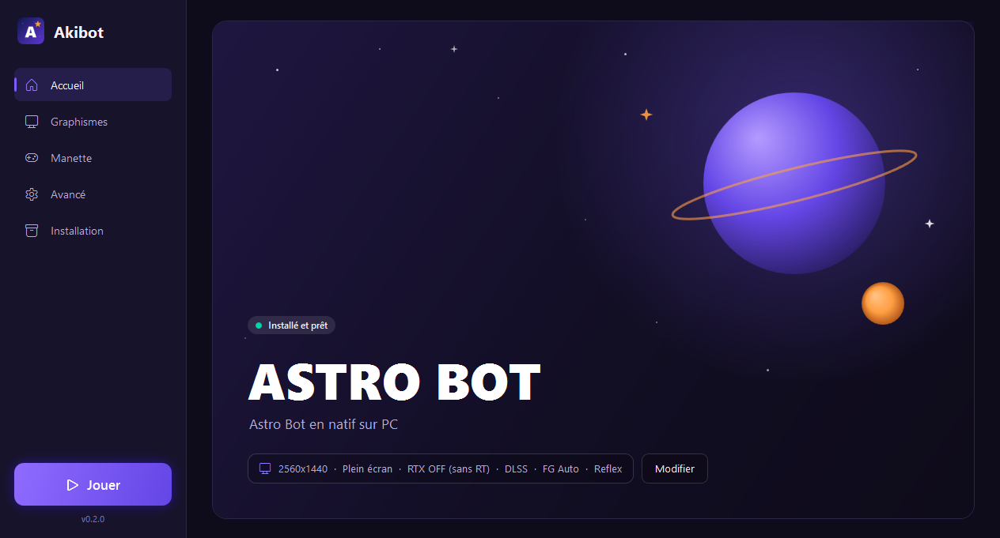
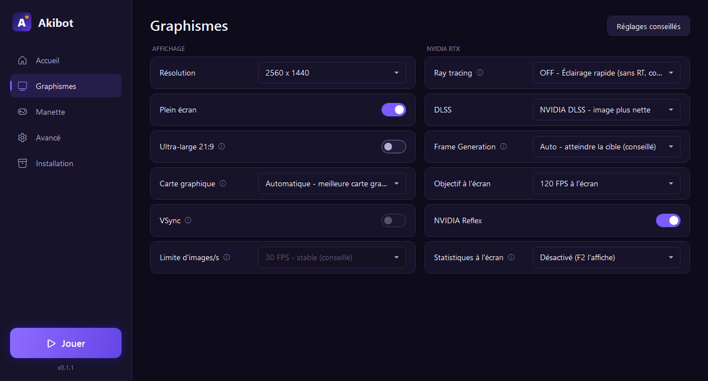

# AkiBot

<a href="https://recomplauncher.com"><picture><source media="(prefers-color-scheme: dark)" srcset="https://recomplauncher.com/assets/press/launcher/badge-light.svg"></picture></a>

Fork personnel du [portage PC natif d'**Astro Bot**](https://github.com/imnotsharingmyname/pcportastrobot)
(PS5) par imnotsharingmyname. Le but d'AkiBot : **plus de FPS, moins de saccades** et des réglages adaptés, en
travaillant sur la couche de traduction (CPU et GPU), jamais sur le jeu lui-même.

> [!IMPORTANT]
> **Aucun fichier du jeu n'est dans ce dépôt, et il n'y en aura jamais** : ni exécutable, ni données, ni
> shaders, ni clés, ni sauvegardes. Il faut ton propre dump décrypté d'Astro Bot, issu de ta propre copie.
> Le setup le convertit sur ton PC sans le modifier.

## État actuel

Version **0.3.0** : premier runtime 100 % AkiBot, DLSS / FSR / génération d'images et menu en jeu.

- **Menu en jeu** (F1 ou Échap, manette comprise) avec toutes les options du lanceur. Limite de FPS, compteur,
  plein écran et vitesse du jeu changent en direct ; le reste est enregistré pour le prochain lancement (« * »).
- **DLSS** (Qualité, Équilibré, Performance, Ultra Performance, DLAA) et **génération d'images NVIDIA** (×2 à ×4)
  qui marchent maintenant aussi sur la **v01.007.000** (passe d'upscale de cette version retrouvée).
- **AMD FSR 3.1** (mise à l'échelle) et **génération d'images AMD FSR 3** (×2), sur toutes les cartes.
- Le compteur de FPS compte les images générées (NVIDIA et AMD).
- **Runtime AkiBot** : `kyty_gpu.dll` recompilée avec Streamline et FidelityFX, module hôte AnyPS5 au nom
  d'AkiBot. Les autres bibliothèques PS5 restent celles d'origine (elles contiennent des correctifs absents des
  sources publiées).
- **Plus aucun .bat** : AkiBot.exe démarre le jeu lui-même. Les installations 0.1.x / 0.2.x sont migrées
  automatiquement au premier démarrage (raccourcis et anciens scripts compris).
- Journal de lancement `Logs\akibot-launch.log` (options passées au jeu) pour comparer un lancement qui plante.

| Sky Garden, 1440p (9800X3D + RTX 5070) | FPS du jeu | FPS à l'écran |
|---|---|---|
| Natif | ~59 | ~59 |
| DLSS + génération NVIDIA ×4 | ~39 | ~156 |
| FSR 3.1 + génération AMD ×2 | ~58 | ~116 |

> [!WARNING]
> Sur la **v01.007.000**, un plantage aléatoire rare (environ 1 lancement sur 15, au chargement d'un niveau)
> existe depuis le début, sans lien avec AkiBot 0.3.0. Relancer suffit. La solution durable est la mise à jour
> 01.019.000 du jeu.

<p align="center">
  
  
</p>

### Testé sur

| | |
|---|---|
| Jeu | **PPSA21564 v01.007.000** (l'amont teste PPSA21567 v01.019.000) |
| CPU | AMD Ryzen 7 9800X3D |
| GPU | NVIDIA RTX 5070 |
| RAM | 32 Go |
| Écran | 2560×1440, 165 Hz |

### Compatibilité de la v01.007.000

| Fonction | Résultat |
|---|---|
| Validation et setup du dump | ✅ accepté, `AstroBot.exe` construit sans erreur |
| Lancement | ✅ démarre, image correcte, 60 FPS dans l'intro |
| Fin du tutoriel (passage vers l'espace) | ✅ depuis AkiBot 0.1.1 (surveillance des écritures mémoire coupée automatiquement ; avant : écran noir ou plantage) |
| Manette sans gyroscope (Xbox) | ✅ View/Back puis stick droit pour incliner |
| Vitesse temps réel | ✅ |
| Ultrawide 21:9 / 32:9 | ✅ |
| Correctifs du command buffer | ✅ |
| Éclairage rapide (`AstroBot-NonRT`) | ❌ code différent dans cette version, patch ignoré |
| Soft-assert du command buffer | ❌ idem |
| Patch physique des tissus | ❌ idem |

### Mesures de référence (Sky Garden)

Lancement direct dans le niveau (`-lvl underwater_aerial_garden`), 2560×1440 natif, sans DLSS ni génération
d'images, sans limite de FPS, éclairage d'origine. FPS relevé chaque seconde pendant 120 s après 25 s de chauffe.

| Essai | Moyenne | Médiane | Pire seconde | Secondes sous 50 FPS |
|---|---|---|---|---|
| AkiBot 0.1.1 (correctif actif), cache froid | 63,6 | 65 | 15 | 2 |
| Sans le correctif (`APS5_NO_WRITE_WATCH=0`) | 61,5 | 64 | 0 | 7 |
| AkiBot 0.1.1 (correctif actif), cache chaud | 61,9 | 63 | 42 | 3 |

**~62 FPS de moyenne** sur Ryzen 7 9800X3D + RTX 5070 (l'amont mesure 32-34 FPS au même endroit avec un
Ryzen 5 5500 + RTX 5060). Le correctif 0.1.1 ne coûte pas de FPS. Le jeu reste limité par le CPU (préparation des
draws sur un seul thread, plafond ~70 FPS) : c'est la cible des optimisations à venir.

`kyty_gpu.dll` recompilée par AkiBot contre celle de la release, mesurées l'une après l'autre dans la même
séance : **58,5 contre 58,3 FPS** de moyenne (1 % bas 56 contre 55). Performances identiques ; l'écart avec les
~62 FPS ci-dessus vient de l'état du PC ce jour-là. Toujours comparer deux versions dans la même séance.

Pour refaire la mesure sur ton PC : `powershell -ExecutionPolicy Bypass -File Tools\akibot\bench_level.ps1 -InstallDir C:\AkiBot`
(le jeu s'ouvre et se ferme tout seul ; résultat dans la console et un CSV à côté du script).

## Jouer

1. Télécharge **AkiBot.exe** depuis la [dernière release](https://github.com/Razoc/AkiBot/releases/latest)
   (un seul fichier, environ 1,4 Mo).
2. Lance-le. Choisis la langue et le dossier d'installation (par exemple `C:\AkiBot`, hors OneDrive, environ
   3 Go libres). AkiBot télécharge le runtime AkiBot (192 Mo) et vérifie son empreinte SHA-256.
3. Indique le dossier de ton dump (celui qui contient `eboot.bin`, `sce_module` et `sce_sys`). La conversion
   prend environ une minute ; ton dump n'est jamais modifié.
4. Règle les graphismes et la manette si tu veux, puis appuie sur **Jouer** (en bas à gauche).

AkiBot vérifie les nouvelles versions à chaque démarrage et se met à jour tout seul (la 0.2.0 propose
la 0.3.0, qui installe ensuite son nouveau runtime). Windows SmartScreen peut
avertir au premier lancement (exe non signé) : « Informations complémentaires » puis « Exécuter quand même ».

Sans fenêtre : `AkiBot.exe --install "<dossier>"`, puis `AkiBot.exe --setup "<dossier du dump>"` depuis le
dossier d'installation. `AkiBot.exe --play` lance le jeu avec les réglages enregistrés ;
`AkiBot.exe --run <arguments>` le lance avec ses propres arguments (ex. `-lvl underwater_aerial_garden`).

### Avec RecompLauncher

AkiBot fournit un `recomplauncher.json` dans le zip `AkiBot-v<version>-Windows-x64.zip` de chaque release :
[RecompLauncher](https://recomplauncher.com) demande ton dossier de dump, installe le runtime et convertit le jeu
(`AkiBot.exe --prepare "<dossier du dump>"`, sans fenêtre), affiche les réglages graphiques sur la page du jeu,
puis lance la partie avec `AkiBot.exe --play`. En mode Big Picture, le jeu s'ouvre en plein écran.

> English: download **AkiBot.exe** from the latest release, run it, pick a language and an install folder,
> then point it at your own Astro Bot dump. AkiBot updates itself.

## Compiler `kyty_gpu.dll`

Prérequis : Visual Studio 2022 Build Tools (C++ x64) + SDK Windows, **LLVM 22.1.3** (clang-cl ; les versions
plus récentes ne lisent pas le profil PGO), SDK Vulkan 1.4.363.0, CMake, Ninja, Python 3, Git.

```
git clone https://github.com/Jetsku/KytyPS5.git kyty
cd kyty
git config core.autocrlf false
git checkout u59-windows-20261024-int21
git submodule update --init --recursive
git am --keep-cr ..\AkiBot\Source\kyty-hybrid\*.patch
powershell -ExecutionPolicy Bypass -File ..\AkiBot\Tools\hybrid\build-kyty-pgo.ps1
```

- Place `kyty` à côté du dépôt AkiBot (le script cherche `..\kyty`) ou indique `KYTY_SRC`. Résultat :
  `..\kyty-gpu\kyty_gpu.dll`, en environ 3 min sur un 9800X3D.
- `core.autocrlf false` est obligatoire : sinon les patchs ne s'appliquent pas. Si ton clone d'AkiBot a été fait
  avec `autocrlf true`, applique les patchs tirés de Git (`git show HEAD:Source/kyty-hybrid/<patch>`).
- Sans `KYTY_STREAMLINE_DIR` (SDK Streamline 2.14.16), la DLL est construite sans DLSS ni génération d'images
  NVIDIA ; sans `KYTY_FFX_DIR` (AMD FidelityFX SDK 1.1.4), sans FSR.
- Paquet runtime complet : `powershell -ExecutionPolicy Bypass -File Tools\release\make_runtime.ps1 -Version 0.3.0`.
- Pour tester : garde une copie de `Build\RunHybrid\kyty_gpu.dll`, remplace-la, mesure avec `bench_level.ps1`.

## Feuille de route

- [x] Mesurer une base de FPS fiable dans Sky Garden (~62 FPS en 1440p natif, voir plus haut). Autres niveaux à faire.
- [x] Lanceur refait : fenêtre 1280×720 épurée (0.2.0).
- [x] Compiler `kyty_gpu.dll` depuis les sources et retrouver les perfs de la release.
- [x] Compiler `kyty_gpu.dll` avec Streamline et FidelityFX ; runtime AkiBot (0.3.0).
- [x] DLSS et génération d'images NVIDIA sur la v01.007.000 ; AMD FSR 3.1 et génération d'images AMD (0.3.0).
- [x] Menu en jeu F1 / Échap (0.3.0).
- [ ] Comprendre pourquoi la génération NVIDIA ×4 fait tomber le jeu de ~59 à ~39 FPS.
- [ ] Profiler le « draw commit » du command processor (~22 ms par image sur un seul thread CPU, ~4 900 draws
      par image) et chercher des gains.
- [ ] Porter l'éclairage rapide et le soft-assert sur la v01.007.000.
- [ ] Préréglages pour les CPU X3D et les RTX 50.

## Contribuer

Les idées, mesures et pull requests sont les bienvenues :

- Ouvre une issue avec ta config (CPU, GPU, RAM, pilote), la version de ton dump (`sce_sys/param.json` →
  `titleId` et `contentVersion`) et ce que tu as mesuré.
- Joins les logs (`Logs\setup.log`, `Logs\akibot-launch.log`, `Logs\hybrid-run.err.log`) **après avoir retiré tes chemins perso**.
- Ne publie **jamais** de fichier du jeu, ni `AstroBot.exe`, ni le dossier `Build\` : c'est du code du jeu
  converti.

Les améliorations utiles à tous seront aussi proposées au projet d'origine.

## Crédits

AkiBot n'existe que grâce à ces projets :

- **[pcportastrobot](https://github.com/imnotsharingmyname/pcportastrobot)** (imnotsharingmyname) : le
  portage dont ce dépôt est un fork. Son README d'origine (en anglais) est dans [Docs/README-amont.md](Docs/README-amont.md).
- **AnyPS5** (boykopovar) : convertit le code x86-64 du jeu en exécutable Windows et réimplémente les
  bibliothèques système PS5.
- **KytyPS5 / Kyty** : la pile GPU traduite vers Vulkan (`kyty_gpu.dll`).
- **NVIDIA Streamline** : DLSS, Frame Generation et Reflex.
- **AMD FidelityFX SDK** (licence MIT) : FSR 3.1 et génération d'images FSR 3.

Astro Bot est une marque de Sony Interactive Entertainment. Ce projet n'est ni affilié à Sony ni approuvé par
Sony.
